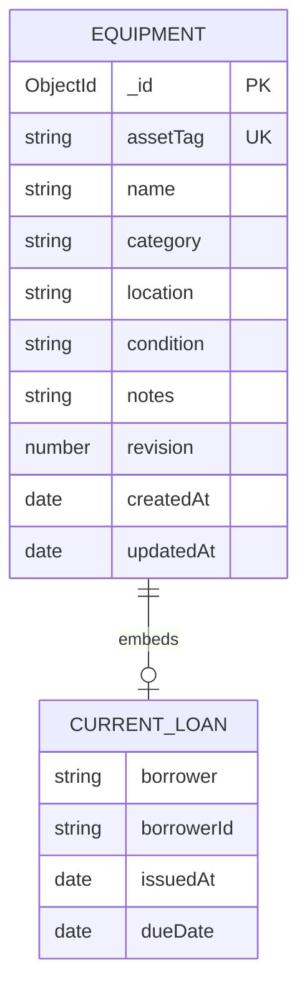

# Database and REST API

## Data model

One `equipments` collection. MongoDB `_id` is the primary identifier; `assetTag` has a unique index. Core fields: name String(100), assetTag String(40), category enum, location String(100), condition enum, notes String(500), revision Number, createdAt Date, updatedAt Date.

`loan` is null or one embedded object: borrower String(100), borrowerId String(50), issuedAt Date, dueDate Date. This is a bounded one-to-zero-or-one relationship. Borrower ID is a recorded identifier, not a foreign key to an existing members collection. MongoDB does not enforce a foreign key here.



Mongoose validators enforce enum, required and length constraints for application writes; MongoDB's unique index enforces tag uniqueness. A separate MongoDB collection-level JSON Schema validator is not configured. Direct database writes bypass Mongoose validation.

## API base: http://localhost:5000/api

| Method | Route | Purpose |
| --- | --- | --- |
| GET | /health | API and database status |
| GET | /equipment | List / search / filter / sort |
| GET | /equipment/:id | One equipment record |
| POST | /equipment | Create equipment |
| PUT | /equipment/:id | Update editable fields |
| DELETE | /equipment/:id | Delete unissued equipment |
| POST | /equipment/:id/issue | Issue available equipment |
| POST | /equipment/:id/return | Return issued equipment |

List query parameters: q, category, status (available/issued/overdue/maintenance), sort (newest/name/assetTag). Issued filter includes overdue loans. Search input is escaped before creating MongoDB regular-expression queries.

Create body:

```json
{"name":"Epson Projector","assetTag":"LIB-PROJ-001","category":"Projector","location":"Media Room","condition":"Good","notes":"HDMI cable included"}
```

Update sends the same editable fields plus the current revision. Issue sends borrower, borrowerId, future ISO dueDate and revision. Return and delete send `{ "revision": 0 }` where 0 is replaced with the current record revision.

Never assume the revision is always zero: each successful update/issue/return increments it. Mutation queries include `_id` and revision atomically so stale requests fail with HTTP 409. Issue also atomically requires no loan and a condition other than Needs repair. Delete atomically requires no loan.

Responses: 201 create, 200 successful reads/other writes, 400 validation/invalid ID, 404 missing record/route, 409 duplicate tag/conflict/action unavailable, 500 unexpected server error. Delete returns 409 for missing or changed records as well as issued records. Errors are JSON `{ "message": "..." }`.
